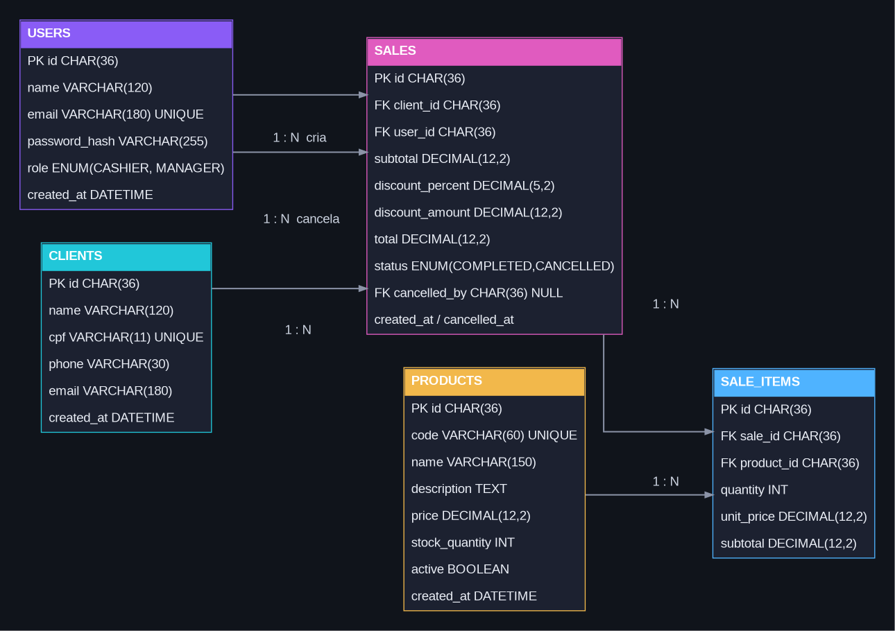

# DER — MS² Vestuário

## Diagrama Entidade-Relacionamento

### Entidades

- **USERS** — usuários do sistema e seus níveis de acesso (Caixa/Gerente).
- **CLIENTS** — clientes, com CPF único.
- **PRODUCTS** — catálogo e estoque de produtos.
- **SALES** — cabeçalho das vendas, cliente, operador, descontos, total e cancelamento.
- **SALE_ITEMS** — itens de cada venda, permitindo vários produtos em uma mesma venda.

### Relacionamentos

- `CLIENTS 1:N SALES`: um cliente pode possuir várias vendas.
- `USERS 1:N SALES`: um usuário pode registrar várias vendas.
- `USERS 1:N SALES`: um gerente pode ser responsável pelo cancelamento de várias vendas.
- `SALES 1:N SALE_ITEMS`: uma venda possui um ou mais itens.
- `PRODUCTS 1:N SALE_ITEMS`: um produto pode aparecer em várias vendas.

A apresentação exige no mínimo **Produtos, Clientes, Vendas e Usuários**. `sale_items` foi acrescentada porque uma venda precisa representar vários produtos de forma normalizada.

**Arquivo visual:** `DER.png`  
**Versão vetorial:** `DER.svg`
